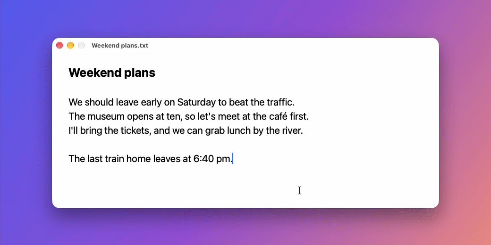
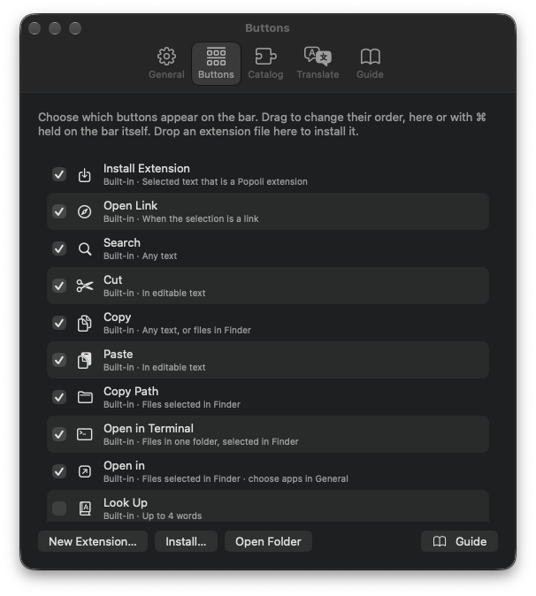
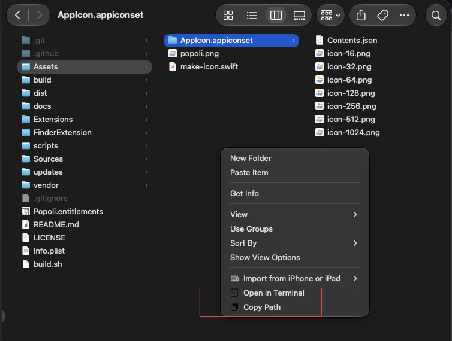

<p align="center">
  
</p>

<h1 align="center">Popoli</h1>

<h3 align="center">A Liquid Glass action bar for the text you select on macOS.</h3>

<p align="center">
  Select text, get the right actions. Right-click in Finder, open a terminal.<br>
  Add your own buttons with a few lines in any language.
</p>

<p align="center">
  <a href="https://github.com/kogungor/popoli/actions/workflows/build.yml"></a>
  
  
  
  
  
  <a href="https://github.com/kogungor/popoli/releases/latest"></a>
  <a href="LICENSE"></a>
</p>

<p align="center">
  <a href="docs/usage.md"><b>User Guide</b></a> ·
  <a href="docs/extensions.md"><b>Writing Extensions</b></a> ·
  <a href="#install"><b>Install</b></a> ·
  <a href="CHANGELOG.md"><b>Changelog</b></a> ·
  <a href="docs/releasing.md"><b>Releasing</b></a> ·
  <a href="LICENSE"><b>License</b></a>
</p>

<p align="center">
  
</p>

> [!NOTE]
> Popoli is in **beta** (0.9). It works well in the apps it has been tried in, but every app exposes its text a little differently. If the bar misbehaves somewhere, please [open an issue](https://github.com/kogungor/popoli/issues) with the app's name.

---

## Features

- **Selection bar:** select text in any app and a glass bar appears above it with the actions that make sense right there: Search, Cut, Copy, Paste, Look Up, Translate and your own.
- **Finder right-click menu:** **Open in Terminal** and **Copy Path** at the top level of Finder's context menu, including on the empty background of a window ("open terminal here").
- **Extensions in any language:** one file with a few `# key: value` lines; zsh, Python, Node, AppleScript, or no code at all for links and shortcuts. Saved files appear instantly.
- **AI-ready extensions:** API keys live in the macOS keychain, never in the script. **Improve Writing** (Claude) ships as an example.
- **Formatted text and Markdown:** extensions can read the selection as HTML or Markdown and paste formatted text back. **Copy as Markdown** and **Rich Text** are included.
- **Your rules:**
  - a keyboard shortcut to show the bar (⌃⌥P),
  - a list of apps where it stays away,
  - a Paste-only bar in empty text fields,
  - ⇧/⌥-click alternatives such as paste-and-match-style.
- **On-device translation and dictionary:** Apple's Translation framework and the macOS dictionary in a glass card, with **From → To** menus.
- **Native and private:** Swift and AppKit, no analytics, nothing sent anywhere except signed update checks. Popoli lives in the menu bar.
- **Updates itself:** signed, notarized releases arrive through Sparkle, with a notification when a new version is out.

## The selection bar

| Button | What it does | When it shows |
|---|---|---|
| **Search** / **Open Link** | Web search, or open the selected link | Any text / a single link |
| **Cut · Copy · Paste** | The usual commands | Cut and Paste only in editable text |
| **Look Up** | Dictionary definition in a card | Up to 4 words |
| **Translate** | On-device translation in a card | Any text |
| **Path** · **Open in Terminal** | Copy the full path, or open a terminal there | Files selected in Finder |
| *your extensions* | Anything | You decide |

Turn buttons on or off and drag to reorder them in **Settings ▸ Buttons**, or hold ⌘ and drag a button on the bar itself. The bar's style can be Dark (default), Light or System. → [User Guide](docs/usage.md#the-selection-bar)

<p align="center">
  
</p>

## Finder right-click menu

| Right-click on… | **Open in Terminal** | **Copy Path** |
|---|---|---|
| a folder | a terminal in that folder | its path |
| a file | a terminal in the file's folder | its path |
| several items | a terminal in the folder they are in (not shown when they are in different folders) | all their paths, one per line |
| the background of a window | a terminal in the folder you're looking at | that folder's path |

<p align="center">
  
</p>

- **Terminal app:** works with Terminal, iTerm, Ghostty, Warp, WezTerm and kitty.
- **On/off:** one switch in **Settings ▸ General**.
- **Safe:** Popoli only ever hands the terminal a folder, never a file, so a script is never run by accident.

→ [User Guide](docs/usage.md#finder-right-click-menu)

## Extensions

Drop a file into `~/.config/popoli/extensions/` and it becomes a button:

```zsh
#!/bin/zsh
# name: Uppercase
# icon: AB
# after: paste

print -rn -- ${(U)POPOLI_TEXT}
```

The selection arrives in `$POPOLI_TEXT` and on stdin, and what the script prints is the result. Links and shortcuts need no code at all:

```
# name: Maps
# icon: map
# url: https://maps.apple.com/?q={text}
```

| Header | |
|---|---|
| `name:` | button title (required) |
| `icon:` | SF Symbol, up to 3 letters, emoji, or image |
| `after:` | `show` · `paste` · `copy` · `none` |
| `match:` | only for selections matching a regex |
| `apps:` | only in these apps |
| `for: files` | work on files selected in Finder |
| `url:` / `keys:` | open a link / press a shortcut, no code |
| `input:` / `output:` | `markdown` or `html` to work with formatted text |
| `setting:` / `secret:` | values the user sets; API keys go to the keychain |

Install extensions others share in one of these ways (you always see the code first):

- select their text: the bar offers **Install Extension**,
- open a `popoli://install?url=…` link,
- drop the file on **Settings ▸ Buttons**.

You don't need to start from scratch either:

- **Menu bar ▸ New Extension…** writes a commented template.
- **Settings ▸ Guide** has ready-made examples you can add with one click.

<p align="center">
  <a href="docs/extensions.md"><b>→ Full guide to writing extensions</b></a>
</p>

## Install

Requires **macOS 26 (Tahoe) or later** on Apple silicon.

**Download:** get `Popoli-<version>.dmg` from the [latest release](https://github.com/kogungor/popoli/releases/latest), open it and drag **Popoli** to Applications. Releases are signed and notarized, and Popoli updates itself from then on.

**Build from source** (needs Xcode's command line tools):

```bash
git clone https://github.com/kogungor/popoli.git
cd popoli
./build.sh install        # build, copy to ~/Applications and launch
```

On first launch, Popoli asks for three things:

1. **Accessibility access:** to read the selection and send ⌘X / ⌘C / ⌘V.
2. **Finder automation:** for Path and Open in Terminal.
3. **The Finder extension:** for the right-click menu, in **Settings ▸ General**.

→ [User Guide](docs/usage.md#install)

| Command | |
|---|---|
| `./build.sh` | build `build/Popoli.app` |
| `./build.sh run` | build and launch |
| `./build.sh install` | build, install to `~/Applications`, launch |

The build signs with your *Apple Development* identity if you have one (set `POPOLI_SIGN_IDENTITY` to choose another), so the Accessibility permission survives rebuilds.

## How it works

- **Reading the selection:**
  - **Accessibility API:** Popoli reads the selection through it.
  - **Edit menu state:** it decides whether Cut and Paste make sense.
  - **⌘C fallback:** for apps that don't expose their selection, Popoli sends ⌘C and then restores your clipboard.
- **Glass surfaces:** non-activating panels built on `NSGlassEffectView`. The app you type in never loses focus.
- **Finder menu:** a sandboxed Finder Sync extension that hands folders to the app over a `popoli://` URL.
- **Extensions:** run as plain processes with a 60-second limit, with the selection in the environment and on stdin.
- **Updates:** Sparkle checks the signed `appcast.xml` attached to the latest GitHub release.

```
Sources/           the app (selection, bar, cards, settings, extensions)
FinderExtension/   the Finder right-click menu
Extensions/        examples installed on first launch
Assets/            logo and app icon
docs/              user guide, extension guide, releasing
scripts/           release script
.github/workflows/ CI: build and smoke tests
```


## Contributing

- **Working on a change:** branch from `dev` and open a pull request to `dev`. It is squash merged once the **Build** check passes.
- **Releasing:** `dev` goes to `main` through a pull request with a merge commit, and releases are made from `main`. See [Releasing](docs/releasing.md).

## License

Popoli is released under the [MIT License](LICENSE).
