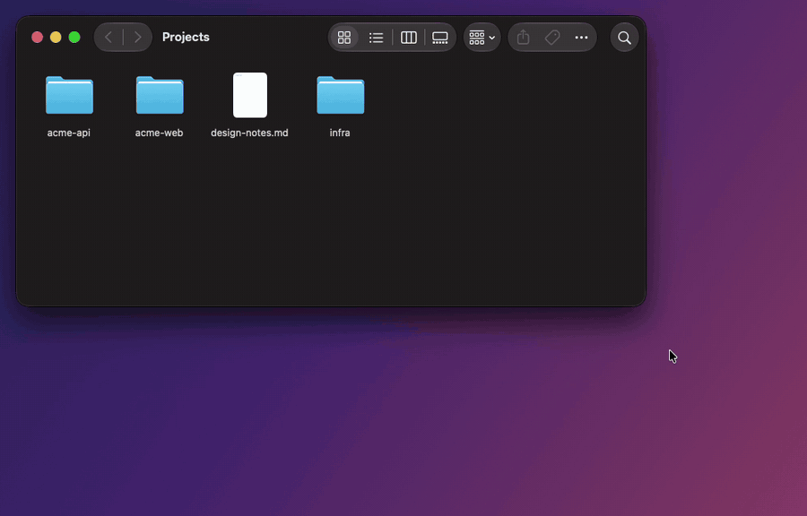

<p align="center">
  
</p>

<h1 align="center">Popoli</h1>

<h3 align="center">A Liquid Glass action bar for the text you select on macOS.</h3>

<p align="center">
  Select text, get the right actions. Right-click in Finder, open a terminal.<br>
  Add your own buttons with a few lines in any language.
</p>

<p align="center">
  <a href="https://github.com/kogungor/popoli/actions/workflows/build.yml"></a>
  
  
  
  
  
  <a href="https://github.com/kogungor/popoli/releases/latest"></a>
  <a href="LICENSE"></a>
</p>

<p align="center">
  <a href="docs/usage.md"><b>User Guide</b></a> ·
  <a href="docs/extensions.md"><b>Writing Extensions</b></a> ·
  <a href="catalog/"><b>Extension Catalog</b></a> ·
  <a href="#install"><b>Install</b></a> ·
  <a href="CHANGELOG.md"><b>Changelog</b></a> ·
  <a href="SECURITY.md"><b>Security</b></a> ·
  <a href="docs/releasing.md"><b>Releasing</b></a> ·
  <a href="LICENSE"><b>License</b></a>
</p>

<p align="center">
  
</p>

> [!NOTE]
> Popoli is in **beta** (0.9). It works well in the apps it has been tried in, but every app exposes its text a little differently. If the bar misbehaves somewhere, please [open an issue](https://github.com/kogungor/popoli/issues/new?template=app-problem.yml) with the app's name and a few lines from the [diagnostics log](docs/usage.md#troubleshooting).

---

## Features

- **Selection bar:** select text in any app and a glass bar appears above it with the actions that make sense right there: Search, Cut, Copy, Paste, Look Up, Translate and your own.
- **Collect as you read:** click **Collect** on the bar to gather snippets from a chat, a page or a document, then paste or copy them all at once, or as Markdown quotes with links back to where they came from. Each page and conversation gets a collection of its own, so they never mix.
- **Finder right-click menu:** **Open in Terminal**, **Open in ›** and **Copy Path** at the top level of Finder's context menu, including on the empty background of a window ("open terminal here").
- **Open in › your editor or AI tool:** open a folder in VS Code, Cursor, Zed, Xcode or a JetBrains IDE, or start Claude Code, Codex or Gemini CLI right there. Popoli finds the ones you have installed.
- **Extensions in any language:** one file with a few `# key: value` lines; zsh, Python, Node, AppleScript, or no code at all for links, key presses, Shortcuts and Services. Saved files appear instantly.
- **Extension catalog:** about 50 ready-made extensions (Calculate, Convert, case and line tools, Decode JWT, Unix Time, Ask ChatGPT, Claude, Perplexity or Gemini, Add to Notes, Merge PDFs…) to browse and install in **Settings ▸ Catalog**.
- **AI-ready extensions:** API keys live in the macOS keychain, never in the script. **Improve Writing** (Claude) ships as an example.
- **Formatted text and Markdown:** extensions can read the selection as HTML or Markdown and paste formatted text back. **Copy as Markdown** and **Rich Text** are included.
- **Your rules:**
  - a keyboard shortcut to show the bar (⌃⌥P),
  - a list of apps where it stays away,
  - a Paste-only bar in empty text fields,
  - ⇧/⌥-click alternatives such as paste-and-match-style.
- **On-device translation and dictionary:** Apple's Translation framework and the macOS dictionary in a glass card, with **From → To** menus.
- **Native and private:** Swift and AppKit, no analytics, nothing sent anywhere except signed update checks. Popoli lives in the menu bar.
- **Updates itself:** signed, notarized releases arrive through Sparkle. Popoli checks every hour and shows a dot on its menu bar icon and a notification when a new version is out.

## The selection bar

<p align="center">
  
</p>

| Button | What it does | When it shows |
|---|---|---|
| **Search** / **Open Link** | Web search, or open the selected link | Any text / a single link |
| **Cut · Copy · Paste** | The usual commands | Cut and Paste only in editable text |
| **Look Up** | Dictionary definition in a card | Up to 4 words |
| **Translate** | On-device translation in a card | Any text |
| **Collect** · **Collected ›** | Add the selection to a collection; paste or copy everything collected | Any text · after you collect |
| **Copy Path** · **Open in Terminal** · **Open in ›** | Copy the full path, open a terminal there, or open it in an editor or AI tool | Files selected in Finder |
| *your extensions* | Anything | You decide |

Every button is an icon; point at one and its name slides in above the bar. Turn buttons on or off and drag to reorder them in **Settings ▸ Buttons**, or hold ⌘ and drag a button on the bar itself. The bar's style can be Dark (default), Light or System. → [User Guide](docs/usage.md#the-selection-bar)

<p align="center">
  
</p>

## Collect as you read

<p align="center">
  
</p>

Select a passage and click **Collect** on the bar. Each page, conversation or document gets a collection of its own, so a chat answer and an article you read in between never mix, and going back to the chat adds to its collection again.

- **Collected ›** on the bar pastes or copies everything at once, each snippet on its own line, or with ⌥ as Markdown quotes with a link back to where each came from.
- **Collections…** in the menu bar menu lists them: rename, drag snippets between collections, merge them, or run an extension such as Ask ChatGPT on all the snippets together.
- A snippet's **↗** opens its page in the browser, scrolled to it and highlighted.
- Collections stay on your Mac and go away a week after you last add to them.

→ [User Guide](docs/usage.md#collections)

## Finder right-click menu

| Right-click on… | **Open in Terminal** | **Copy Path** |
|---|---|---|
| a folder | a terminal in that folder | its path |
| a file | a terminal in the file's folder | its path |
| several items | a terminal in the folder they are in (not shown when they are in different folders) | all their paths, one per line |
| the background of a window | a terminal in the folder you're looking at | that folder's path |

<p align="center">
  
</p>

- **Terminal app:** works with Terminal, iTerm, Ghostty, Warp, WezTerm and kitty.
- **Open in ›:** the selection in your editor (VS Code, Cursor, Windsurf, Zed, Sublime Text, Xcode, JetBrains IDEs…), or an AI tool (Claude Code, Codex, Gemini CLI, OpenCode…) started in a terminal in the folder. Popoli lists what is installed; pick the ones to show, or add your own, in **Settings ▸ General ▸ Open in**.
- **On/off:** one switch in **Settings ▸ General**.
- **Safe:** Popoli only ever hands the terminal a folder, never a file, so a script is never run by accident.

→ [User Guide](docs/usage.md#finder-right-click-menu)

## Extensions

The bar offers what fits the selection: the recording at the top uses **Decode JWT**, **camelCase** and **Convert** from the [catalog](catalog/).

Drop a file into `~/.config/popoli/extensions/` and it becomes a button:

```zsh
#!/bin/zsh
# name: Uppercase
# icon: AB
# after: paste

print -rn -- ${(U)POPOLI_TEXT}
```

The selection arrives in `$POPOLI_TEXT` and on stdin, and what the script prints is the result. Links, key presses, Shortcuts and Services need no code at all:

```
# name: Maps
# icon: map
# url: https://maps.apple.com/?q={text}
```

| Header | |
|---|---|
| `name:` | button title (required) |
| `icon:` | SF Symbol, up to 3 letters, emoji, or image |
| `after:` | `show` · `paste` · `copy` · `none` |
| `match:` | only for selections matching a regex |
| `apps:` | only in these apps |
| `for: files` | work on files selected in Finder |
| `url:` / `keys:` | open a link / press a shortcut, no code |
| `shortcut:` / `service:` | run a shortcut from the Shortcuts app / a service from the Services menu, no code |
| `input:` / `output:` | `markdown` or `html` to work with formatted text; shown formatted in the card |
| `group:` | share one button with related extensions (**Encode ›**) |
| `description:` | one line for the catalog |
| `setting:` / `secret:` | values the user sets; API keys go to the keychain |

**Ready-made extensions:** **Settings ▸ Catalog** lists about 50 from the [catalog](catalog/), such as Calculate, Convert (units and currencies), case and line tools (camelCase, Sort Lines…), Ask ChatGPT, Claude, Perplexity or Gemini with your own account, Encode and Decode, Format JSON, Unix Time, QR codes, Add to Notes, Reminders, Things or Calendar, Merge PDFs and image conversion. Search, pick one, and install it with a click.

Install extensions others share in one of these ways (you always see the code first):

- select their text: the bar offers **Install Extension**,
- open a `popoli://install?url=…` link,
- drop the file on **Settings ▸ Buttons**.

You don't need to start from scratch either:

- **Menu bar ▸ New Extension…** writes a commented template.
- **Settings ▸ Guide** has ready-made examples you can add with one click.

<p align="center">
  <a href="docs/extensions.md"><b>→ Full guide to writing extensions</b></a>
</p>

## Install

Requires **macOS 26 (Tahoe) or later** on Apple silicon.

**Download:** get `Popoli-<version>.dmg` from the [latest release](https://github.com/kogungor/popoli/releases/latest), open it and drag **Popoli** to Applications. Releases are signed and notarized, and Popoli updates itself from then on.

**Homebrew:**

```bash
brew install --cask kogungor/tap/popoli
```

**Build from source** (needs Xcode's command line tools):

```bash
git clone https://github.com/kogungor/popoli.git
cd popoli
./build.sh install        # build, copy to ~/Applications and launch
```

On first launch, Popoli asks for three things:

1. **Accessibility access:** to read the selection and send ⌘X / ⌘C / ⌘V.
2. **Finder automation:** for Copy Path, Open in Terminal and Open in ›.
3. **The Finder extension:** for the right-click menu, in **Settings ▸ General**.

→ [User Guide](docs/usage.md#install)

| Command | |
|---|---|
| `./build.sh` | build `build/Popoli.app` |
| `./build.sh run` | build and launch |
| `./build.sh install` | build, install to `~/Applications`, launch |

The build signs with your *Developer ID* identity if you have one, otherwise with *Apple Development* (set `POPOLI_SIGN_IDENTITY` to choose another), so the Accessibility permission survives rebuilds and is shared with an installed release.

## How it works

- **Reading the selection:**
  - **Accessibility API:** Popoli reads the selection through it.
  - **Edit menu state:** it decides whether Cut and Paste make sense.
  - **⌘C fallback:** for apps that don't expose their selection, Popoli sends ⌘C and then restores your clipboard.
- **Glass surfaces:** non-activating panels built on `NSGlassEffectView`. The app you type in never loses focus.
- **Finder menu:** a sandboxed Finder Sync extension that hands folders to the app over a `popoli://` URL.
- **Extensions:** run as plain processes with a 60-second limit, with the selection in the environment and on stdin.
- **Updates:** Sparkle checks the signed `appcast.xml` attached to the latest GitHub release.

```
Sources/           the app (selection, bar, cards, settings, extensions)
FinderExtension/   the Finder right-click menu
catalog/           ready-made extensions; starter.txt lists those installed on first launch
Assets/            logo and app icon
docs/              user guide, extension guide, releasing
scripts/           release, DMG and catalog index scripts
.github/workflows/ CI: build and smoke tests
```


## Contributing

- **Working on a change:** branch from `dev` and open a pull request to `dev`. It is squash merged once the **Build** check passes.
- **Releasing:** `dev` goes to `main` through a pull request with a merge commit, and releases are made from `main`. See [Releasing](docs/releasing.md).

## License

Popoli is released under the [MIT License](LICENSE).
