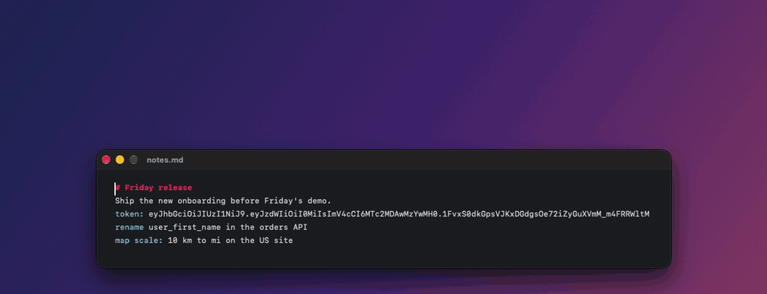

# Extension catalog

Ready-made extensions for Popoli. Each one is a single file: pick the ones you want.

  

They need **Popoli 0.9.4** or later, for groups and formatted cards. Extensions run on your Mac with your permissions, and Popoli shows you the code of every extension before it installs it.

## Installing

- **In Popoli (0.9.5 or later):** open **Settings ▸ Catalog**, find the extension, and click **Install**.
- **From the link:** open the file below, copy its address, then choose **Install Extension…** in Popoli's menu bar menu and paste it.
- **From the text:** open the file, click **Raw**, select all the text, and click **Install Extension** on the bar.
- **From a download:** drop the file on **Settings ▸ Buttons**.

## Text

| Extension | What it does | Shows for |
|---|---|---|
| [Calculate](calculate.js) | Works out `12*(3+4)/2`, `2^10`, `1,5*2` | Calculations |
| [Convert](convert.js) | `10 km to mi`, `70 F in C`, `100 USD to EUR`, `250 ₺ to €` | `<amount> <unit> to <unit>` |
| [Color](color-preview.sh) | Shows a swatch of `#FF8800`, `rgb(…)` or `hsl(…)` | Colors |
| [Call](call.sh) | Calls the number with FaceTime or your iPhone | Phone numbers |
| [Email](email.sh) | Starts an email to the address | Email addresses |

**Convert:** lengths, weights, volumes and other units come from macOS's `units` tool. Currency rates are the European Central Bank's, fetched from [frankfurter.dev](https://frankfurter.dev); that is the only extension here that goes online.

## Case › and Lines ›

Each group shares one button on the bar and shows only the tools that fit the selection. Text with Turkish or Azerbaijani letters (ğ, ş, ı, İ) gets their rules for the dotted and dotless i: İ ↔ i and I ↔ ı.

| Extension | Group | What it does | Shows for |
|---|---|---|---|
| [Uppercase](uppercase.sh) | Case | `HELLO WORLD` | Text with lowercase letters |
| [Lowercase](lowercase.sh) | Case | `hello world` | Text with capitals |
| [Title Case](title-case.py) | Case | `Hello World`, keeping "Don't" and acronyms such as NASA | Any text |
| [Sentence case](sentence-case.js) | Case | `Hello world. Second sentence` | Any text |
| [camelCase](camel-case.js) | Case | `helloWorld`; ⇧-click for `HelloWorld` | Lines up to 100 characters, each converted |
| [snake_case](snake-case.js) | Case | `hello_world`; ⇧-click for `HELLO_WORLD` | Lines up to 100 characters |
| [kebab-case](kebab-case.js) | Case | `hello-world` | Lines up to 100 characters |
| [Slug](slug.js) | Case | `Crème brûlée, s’il vous plaît!` → `creme-brulee-s-il-vous-plait` | Lines up to 100 characters |
| [Sort Lines](sort-lines.js) | Lines | A to Z with numbers in order (2 before 10); ⇧-click for Z to A | Two or more lines |
| [Remove Duplicates](remove-duplicate-lines.js) | Lines | Keeps the first of each repeated line | Two or more lines |
| [Join Lines](join-lines.js) | Lines | One line, joined with a space or the `SEPARATOR` setting | Two or more lines |
| [Trim Whitespace](trim-whitespace.js) | Lines | Removes spaces at line ends, repeated spaces and extra blank lines | Text with extra whitespace |

## Ask ›

The selection goes to the AI in your browser, where you are signed in, so it uses your own account and subscription. No API key is needed. The `PROMPT` setting puts your instruction before the selection, for example *Explain this:*.

| Extension | What it does |
|---|---|
| [ChatGPT](ask-chatgpt.js) | Asks ChatGPT right away |
| [Claude](ask-claude.js) | Opens a new Claude chat with the selection |
| [Perplexity](ask-perplexity.js) | Searches with Perplexity right away |
| [Gemini](ask-gemini.js) | Gemini's site takes no text from links, so Popoli copies it and opens Gemini: paste with ⌘V |

A very long selection doesn't fit in a link; it is copied instead, and Popoli says so.

## Encode › and Decode ›

Each group shares one button on the bar.

| Extension | Group | What it does | Shows for |
|---|---|---|---|
| [Base64](base64-encode.sh) | Encode | Encodes the text as Base64 | Any text |
| [URL Encode](url-encode.js) | Encode | Percent-encodes it for a URL | Any text |
| [HTML Escape](html-escape.js) | Encode | `<` → `&lt;`, `&` → `&amp;`… | Any text |
| [QR Code](qr-code.js) | Encode | Shows a QR code of the text | Any text |
| [Base64](base64-decode.js) | Decode | Decodes Base64, also the URL-safe kind | Base64-looking text |
| [URL Decode](url-decode.js) | Decode | `%20` → space | Text with `%XX` |
| [HTML Unescape](html-unescape.js) | Decode | `&eacute;` → é, `&#x41;` → A | Text with `&…;` |

## Developer ›

| Extension | What it does | Shows for |
|---|---|---|
| [Format JSON](json-format.js) | Pretty-prints JSON | Text starting with `{` or `[` |
| [Minify JSON](json-minify.js) | Puts JSON on one line | Text starting with `{` or `[` |
| [Unix Time](unix-time.js) | `1700000000` → your time, UTC and "2 years ago" (seconds or milliseconds) | 9–13 digit numbers |
| [Hex ↔ Decimal](hex-decimal.js) | Decimal, hex and binary of a number | Numbers, hex |
| [Decode JWT](jwt-decode.js) | Header, claims and expiry of a JSON Web Token (the signature is not checked) | `eyJ….….…` |
| [SHA-256](sha256.sh) | The SHA-256 hash of the text | Any text |

## Add to ›

| Extension | What it does | Notes |
|---|---|---|
| [Notes](add-to-notes.applescript) | A new note with the text | macOS asks once whether Popoli may use Notes |
| [Reminders](add-to-reminders.applescript) | A reminder: the first line is the title | macOS asks once whether Popoli may use Reminders |
| [Things](add-to-things.popoli) | A to-do in Things | |
| [Todoist](add-to-todoist.popoli) | Opens Todoist's quick add with the text | |
| [Obsidian](add-to-obsidian.js) | A note named after the first line | Setting `OBSIDIAN_VAULT`: empty uses the vault that is open |
| [Calendar](add-to-calendar.js) | Finds a date in the text ("lunch next Friday at 1pm") and opens the event in Calendar to add | No permission needed |

## Files selected in Finder

| Extension | What it does |
|---|---|
| [Copy as Markdown Link](copy-markdown-link.js) | `[name](file:///…)` for each file |
| [Copy Contents](copy-contents.sh) | Copies the text of text files (up to 2 MB) |
| [SHA-256](file-hash.sh) | The SHA-256 hash of each file |
| [Merge PDFs](merge-pdfs.js) | Joins the selected PDFs, in name order, into `Merged.pdf` |
| [Resize](image-resize.sh) · Image › | A copy whose longest side is 1600 px (setting `SIZE`) |
| [To JPEG](image-to-jpeg.sh) · Image › | A JPEG copy of each image |
| [To PNG](image-to-png.sh) · Image › | A PNG copy of each image |

## Writing your own

See [Writing Extensions](../docs/extensions.md). To add yours here, open a pull request with:

- the file, with a `# description:` line last in its header,
- a line in this list,
- the updated `index.json`: run `scripts/catalog-index.sh`, which builds Popoli and writes it. **Settings ▸ Catalog** reads that list, and CI checks that it matches the files.

`starter.txt` lists the extensions Popoli installs on first launch.
