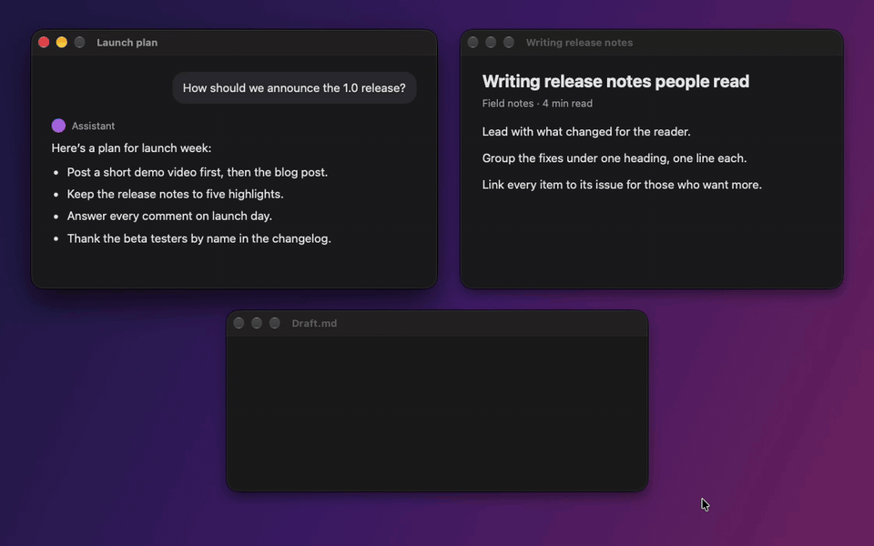

<p align="center">
  
</p>

<h1 align="center">Popoli User Guide</h1>

<p align="center">
  <a href="../README.md">Home</a> ·
  <b>User Guide</b> ·
  <a href="extensions.md">Writing Extensions</a>
</p>

---

- [Install](#install)
- [First launch](#first-launch)
- [The selection bar](#the-selection-bar)
- [Keyboard shortcut](#keyboard-shortcut)
- [Apps where the bar stays away](#apps-where-the-bar-stays-away)
- [Translation](#translation)
- [Dictionary](#dictionary)
- [Finder right-click menu](#finder-right-click-menu)
- [Settings](#settings)
- [The menu bar menu](#the-menu-bar-menu)
- [Updates](#updates)
- [Troubleshooting](#troubleshooting)
- [Privacy](#privacy)
- [Uninstall](#uninstall)

## Install

Popoli needs **macOS 26 (Tahoe) or later** on Apple silicon.

**Download:** get `Popoli-<version>.dmg` from the [latest release](https://github.com/kogungor/popoli/releases/latest), open it and drag **Popoli** to the Applications folder. Releases are signed and notarized, and new versions arrive through **Check for Updates…**.

**Homebrew:** `brew install --cask kogungor/tap/popoli`. Popoli still updates itself; `brew upgrade --cask --greedy popoli` updates it through Homebrew instead.

**Build from source:**

```bash
git clone https://github.com/kogungor/popoli.git
cd popoli
./build.sh install     # builds, copies to ~/Applications and launches
```

`./build.sh run` builds and launches it from the `build/` folder instead. You need Xcode's command line tools (`swiftc`). The build signs the app with the *Developer ID* identity in your keychain, otherwise the first *Apple Development* one, or ad-hoc if there is none.

Popoli is a menu bar app: it has no Dock icon. Look for its icon in the menu bar.

## First launch

Popoli asks for three things, each once:

1. **Accessibility.** Required to read the selected text and to press ⌘X / ⌘C / ⌘V in the app you are working in.
   - Turn on **Popoli** in *System Settings ▸ Privacy & Security ▸ Accessibility*.
   - Until you do, the menu bar icon is dimmed.
2. **Finder automation.** The first time you select files in Finder, macOS asks whether Popoli may control Finder. This is needed for **Copy Path**, **Open in Terminal** and **Open in ›** on the bar.
3. **Finder extension.** For the right-click menu, open **Settings ▸ General** and turn on **Right-click menu**.

## The selection bar

Select text in any app and the bar appears above the selection. It shows up after you:

- drag to select,
- double- or triple-click a word or line,
- shift-click to extend a selection.

Hold **⌘** or **⌃** while selecting if you don't want the bar this time.

The bar goes away when you:

- click elsewhere,
- start typing,
- scroll,
- move the mouse away from it.

### Buttons

Every button is an icon. Point at one and its name slides in above the bar, with what ⇧ or ⌥ does where there is something; move along the bar and the name follows. A group (**Open in ›**, **Encode ›**…) shows a small chevron after its icon and lists what is inside.

Each button appears only where it makes sense:

| Button | What it does | When it shows |
|---|---|---|
| **Install Extension** | Opens the review window for an extension shared as text | The selection is a Popoli extension |
| **Search** | Searches Google for the selection | Any text up to 1,000 characters (not a link) |
| **Open Link** | Opens the link in your browser | The selection is a single web link |
| **Cut** | ⌘X | In editable text |
| **Copy** | ⌘C, then shows *Copied* | Any text, or files in Finder |
| **Paste** | ⌘V | In editable text, when the clipboard has something |
| **Collect** | Adds the selection to a collection ([details](#collections)) | Any text |
| **Collected ›** | **Paste All**, **Copy All** and **Show Collections** for what you collected last | After you collect, until you paste or copy it |
| **Copy Path** | Copies the full path of the selected files | Files selected in Finder |
| **Open in Terminal** | Opens a terminal in that folder, or in the folder the selected files are in | Files in one folder, selected in Finder |
| **Open in ›** | Opens them in an editor, or starts an AI tool there ([details](#open-in--your-editor-or-ai-tool)) | Files selected in Finder |
| **Look Up** | Shows the dictionary definition in a card | Up to 4 words |
| **Translate** | Translates in a card | Any text up to 5,000 characters |
| *Extensions* | Your own actions | See [Writing Extensions](extensions.md) |

- **Order and visibility:** you can turn every button on or off and drag to reorder them in **Settings ▸ Buttons**.
- **Rearranging on the bar:** hold ⌘ and drag a button along the bar. The new order is saved and is the same one Settings shows. A ⌘-click that doesn't move stays a click. (Not on the bar for Finder files: there ⌘ selects more files.)
- **More than 11 buttons:** the bar shows them in pages with **‹** and **›** arrows.

### Files in Finder

When you click a file or folder in Finder, the bar offers **Copy**, **Copy Path**, **Open in Terminal** and **Open in ›**, along with any extensions written for files. You can switch this off in **Settings ▸ General ▸ Show the bar for files selected in Finder**.

To select more files, hold ⌘ or ⇧ and click them as usual. The bar steps aside while the key is down, so it never covers the next file, and comes back for all the selected files when you let go.

### Look

The bar, cards and notifications use macOS 26's Liquid Glass. **Settings ▸ General ▸ Style** has three options:

- **Dark** (default): smoky glass with white text. It stays readable on white pages.
- **Light:** light glass with dark text.
- **System:** plain glass that follows the content behind it.

### Hold ⇧ or ⌥ for more

Some buttons do something else when you hold a key while clicking (their label says so):

| Button | ⇧-click | ⌥-click |
|---|---|---|
| **Search** | Searches for the exact phrase (in quotes) | |
| **Copy** | Adds the selection to what is already on the clipboard | |
| **Collect** | Starts a new collection with it | |
| **Collected › Paste All / Copy All** | | As Markdown quotes, each with a link to where it came from |
| **Paste** | | Paste and Match Style (no formatting) |
| **Copy Path** | | Copies the paths quoted for the shell, on one line |
| **Open in ›** (an editor) | | Opens the folder a file is in |
| **Look Up** | | Opens the word in the Dictionary app |
| **Translate** | | Replaces the selection with the translation, without the card |

Extensions can react to the keys too (see [Writing Extensions](extensions.md#modifier-keys)).

### Paste in empty text fields

Click into an empty text field (a search box, a form, an empty note) and a bar with just **Paste** appears, as long as there is something on the clipboard. Password fields are left alone. Turn it off with **Settings ▸ General ▸ Offer Paste in empty text fields**.

## Collections

<p align="center">
  
</p>

Reading a long answer in Claude or ChatGPT, an article or a document, select the parts you want and click **Collect** on the bar (the tray icon). A short note says which collection it went into, and how many snippets it has now. If that text is already in the collection, the note says *Already collected* and nothing is added. When you're done, put them all to use at once.

**Each source gets its own collection.** Popoli asks the app where the selection is:

- in browsers, the page (each page is a collection),
- in apps made of web pages, such as Claude, ChatGPT, Slack or Notion, the conversation or page,
- in document apps, such as TextEdit or Preview, the document,
- elsewhere, the app and its window title.

So when you collect from a Claude chat, switch to a web page for a moment and collect there too, the two don't mix: going back to the chat adds to its collection again. To start a fresh one anyway (two chats with the same title, a second topic on one page), **⇧-click Collect**.

**Using what you collected.** After you collect, the bar also shows **Collected ›** (a stack of cards):

- **Paste All** pastes the snippets, a blank line apart, where you are typing. They stay on the clipboard, so ⌘V pastes them again elsewhere.
- **Copy All** puts them on the clipboard.
- **⌥-click** either one for Markdown: each snippet as a quote, followed by a link to its page.
- **Show Collections** opens the Collections window.

After you paste or copy, **Collected ›** leaves the bar until you collect again; the collection is still in the window.

**The Collections window** (menu bar ▸ **Collections…**) lists your collections, most recent first, with the snippets of the one you select:

- **Copy All**, **Copy as Markdown**, and **Run**, which runs an extension that takes text (Ask ChatGPT, Add to Notes, Word Count…) on all the snippets together.
- Click the name to rename it.
- Drag a snippet onto another collection to move it, or drag it up and down to reorder. Right-click for **Move To ›**, **Copy** and **Delete**.
- Right-click a collection to **Merge Into ›** another one or delete it.
- `popoli://collections` opens the window, for example from a shortcut in the Shortcuts app.
- The **↗** button on a snippet opens its page in the browser, scrolled to the snippet and highlighted (a [text fragment](https://developer.mozilla.org/en-US/docs/Web/URI/Reference/Fragment/Text_fragments) link). For other apps it brings the app forward.

**Collect everything in one place.** For research across many pages, select a collection and click the pin button (or right-click ▸ **Collect Everything Here**): from then on everything you collect goes there, from any app, until you click it again.

**Not using it?** Turn off **Collect** and **Collected** in **Settings ▸ Buttons**, and the bar stays as it was.

**How long they're kept.** Collections are saved on your Mac in `~/Library/Application Support/Popoli/collections.json`, readable only by you, so they survive restarts and updates. A collection is deleted 7 days after you last added to it, unless it collects everything. Turn off **Settings ▸ General ▸ Keep collections when Popoli quits** to keep them only in memory: nothing is written to disk, and they're gone when Popoli quits.

## Keyboard shortcut

Press **⌃⌥P** to show the bar for whatever is selected in the app in front.

- **Placement:** the bar appears right above the selection, wherever the mouse is.
- **Nothing selected:**
  - in a text field, you get Paste;
  - in Finder, you get the actions for the selected files.
- **Excluded apps:** the shortcut works even in [apps where the bar stays away](#apps-where-the-bar-stays-away).

Change or remove it in **Settings ▸ General ▸ Keyboard shortcut**: click the button, then press the new keys. A shortcut needs ⌘, ⌥ or ⌃. Esc cancels.

## Apps where the bar stays away

Some apps don't need the bar, such as games, design tools or a terminal you live in. To keep Popoli out of an app:

- **From the menu:** with that app in front, open the Popoli menu ▸ **Don't Show in *App***, or
- **From Settings:** in **Settings ▸ General ▸ Don't show the bar in**, click **Add App…**.

The keyboard shortcut still works in those apps when you do want the bar.

## Translation

**Translate** opens a card with the translation. It uses Apple's Translation framework and runs **on your Mac**; your text is not sent anywhere.

- **From → To:** the menus at the top of the card change the languages for this translation only.
- **Detect Language:** the source is guessed from the text; the card shows what was detected.
- **Copy** copies the translation. **Replace** puts it in place of the selection (only in editable text).
- **Google** opens the same text in Google Translate.
- Press **Esc**, click ✕, or click anywhere else to close the card.

**Defaults** are in **Settings ▸ Translate**:

| Setting | Meaning |
|---|---|
| Translate from | *Detect automatically*, or always a specific language |
| Translate to | The language you usually want (by default, your Mac's language) |
| If the text is already in that language | The target to use instead (by default, your Mac's second language, or English) |

Each language pair is downloaded the first time you use it, and macOS may ask you to confirm the download. Manage downloads with *Downloaded Languages…* in the same tab, or in *System Settings ▸ General ▸ Language & Region ▸ Translation Languages*. The first translation after launch can take a few seconds while the model loads.

## Dictionary

**Look Up** shows the definition from the dictionaries enabled in the macOS Dictionary app, with **Copy** and a button to open the full entry in Dictionary.

## Finder right-click menu

Popoli adds three items to the **top level** of Finder's context menu (not under Services):

| Item | Right-click on… | Result |
|---|---|---|
| **Open in Terminal** | a folder | a terminal window in that folder |
| | a file | a terminal window in the file's folder |
| | several items in one folder | a terminal window in that folder (with items from different folders, the item is not shown) |
| | the empty background of a Finder window | a terminal window in the folder you are looking at |
| **Open in ›** | a folder, files, or the background | the items in the editor you pick, or an AI tool started in a terminal there (see below) |
| **Copy Path** | one or more items | their full paths, one per line |
| | the empty background | the path of the folder you are looking at |

### Turning it on or off

**Settings ▸ General ▸ Right-click menu** is the switch. It is the same system setting as *System Settings ▸ General ▸ Login Items & Extensions ▸ Finder*, so both always agree.

### Choosing the terminal

**Settings ▸ General ▸ Open in Terminal uses** lists the terminal apps you have installed: Terminal, iTerm, Ghostty, Warp, WezTerm and kitty. The same choice is used by the **Open in Terminal** button on the bar.

Popoli only ever gives the terminal a **folder**. If you right-click a script, it opens the folder the script is in; it never runs the script.

### Open in › your editor or AI tool

**Open in ›** opens what you selected in Finder in an editor, or starts an AI coding tool in that folder. It is in the right-click menu and, as a group, on the bar for files selected in Finder.

- **What Popoli finds:**
  - **Editors and IDEs:** VS Code, Cursor, Windsurf, Zed, Sublime Text, Nova, BBEdit, Xcode, Kiro, Antigravity, Android Studio, the JetBrains IDEs and more.
  - **AI tools:** Claude Code (`claude`), Codex, Gemini CLI, OpenCode, Cursor CLI, Copilot CLI and Aider, wherever your shell finds them.
- **What shows:** at first the three editors you used most recently and every AI tool found. Change it in **Settings ▸ General ▸ Open in**, where **Add App…** and **Add Command…** add anything else, such as `aider --model sonnet`.
- **Editors** get every selected item: a folder opens as a project, a file opens as a file. ⌥-click on the bar opens the folder a file is in.
- **AI tools** start in a new window of the terminal chosen above, in the folder (the one item, or the folder several items are in), and the shell stays open when they end. Terminal and iTerm are controlled through AppleScript, so macOS asks once whether Popoli may do that. Warp can't be told to run a command: Popoli opens the folder in Warp and copies the command for you to paste.
- **Safe:** the right-click menu reaches Popoli with the same secret as Open in Terminal, and only apps and commands turned on in Settings can run, so a web page can't use it.

## Installing extensions

Extensions other people share can be installed in a few ways:

- **From text:** select the extension's text (on GitHub, in a gist, in a message) and click **Install Extension** on the bar.
- **From a link:** open a `popoli://install?url=…` link.
- **From the menu:** use **Install Extension…** to paste a link or choose a file.
- **By dropping it:** drop the file on **Settings ▸ Buttons**.

Popoli always shows what the extension does and its full code first. Details: [Installing and sharing extensions](extensions.md#installing-and-sharing-extensions).

## Settings

Open them from the menu bar icon ▸ **Settings…** (⌘,).

| Tab | What's there |
|---|---|
| **General** | Show the bar for text and for Finder files · Paste in empty text fields · keyboard shortcut · bar style · Finder right-click menu switch · terminal app · Open in editors and AI tools · keeping collections · apps where the bar stays away · updates · launch at login · Accessibility status |
| **Buttons** | Every button, built-in and extensions, with a checkbox, the condition for when it shows, and drag-to-reorder. Extensions have **Edit**, and **Settings…** when they have settings or need an API key; broken ones show the reason in red. |
| **Catalog** | The ready-made extensions from [catalog/](../catalog/): search, filter by category, and install or update one with a click. Each one shows its code before it installs. |
| **Translate** | Default source and target languages and downloaded languages |
| **Guide** | The extension cheat sheet with ready-to-use examples |

## The menu bar menu

| Item | |
|---|---|
| **Enabled** | Turns the bar off and on (the icon dims while off) |
| **Don't Show in *App*** | Keeps the bar out of the app in front |
| **Collections…** | Opens the [Collections](#collections) window |
| **Settings…** | ⌘, |
| **New Extension…** | Creates a commented template and opens it in your text editor |
| **Install Extension…** | Installs an extension from a link or a file, after showing its code |
| **Extension Guide…** | Opens **Settings ▸ Guide** |
| **What’s New…** | Shows the highlights of this version again |
| **Update to Popoli <version>…** | Shown when a new version was found: opens the update window. The menu bar icon has a red dot, and a notification says so too. |
| **Install Popoli <version> and Restart** | Shown instead when the update was already downloaded (automatic downloads): installs it and opens Popoli again |
| **Check for Updates…** | Looks for a new version (official builds) |
| **Quit Popoli** | ⌘Q |

## Updates

Official builds update themselves with Sparkle. By default Popoli checks every hour and asks before installing. **Settings ▸ General ▸ Updates** can:

- turn automatic checks off,
- download and install updates without asking,
- check right now.

When a new version is found, a red dot appears on the menu bar icon, **Update to Popoli <version>…** at the top of the menu, and a notification, once per version. With automatic downloads, the new version installs when you quit Popoli; since a menu bar app rarely quits, the menu offers **Install Popoli <version> and Restart**, and the notification does the same.

Every update is signed, and Popoli verifies the signature before installing. Your settings and extensions are kept.

**After an update**, the first time the new version opens, a small window shows what's new: a few highlights, each with a button to try it, covering every version since the one you had. **What’s New…** in the menu bar menu shows it again, and **All Changes** opens the full list. Buttons that came with the update have a small blue dot on the bar, and NEW in their label, for their first few appearances or until you use them.

Builds you make yourself with `./build.sh` have no update feed until you set one up (see [Releasing](releasing.md)), so they never replace themselves.

## Troubleshooting

**The bar never appears.**

1. Check that **Accessibility** is allowed. The menu bar icon is dimmed if it isn't, and **Settings ▸ General** shows the status.
   - If Popoli is switched on in *System Settings ▸ Privacy & Security ▸ Accessibility* but still asks, the permission belongs to another copy of Popoli, signed differently (for example one built from source). Remove Popoli from the list with **−**, or run `tccutil reset Accessibility app.popoli.Popoli`, then open Popoli again and allow it.
2. Check that **Enabled** is ticked in the menu bar menu.
3. A few apps, such as Sublime Text and VS Code, don't expose their selection to Accessibility. Popoli then copies the selection with ⌘C and restores your clipboard; this needs the app's Edit ▸ Copy to be enabled. Dragging a window to move or resize it never counts as a selection, so it never sends ⌘C.

**Cut or Paste is missing.** They only appear where the text can be edited. On a read-only page that is expected.

**A button is missing.** Check its checkbox and its condition in **Settings ▸ Buttons**. Most buttons only appear for certain selections; Look Up, for example, only appears for up to 4 words.

**The Finder right-click items are missing.**

1. Turn on **Settings ▸ General ▸ Right-click menu**.
2. If it is on but the items still don't appear, restart Finder: `killall Finder` in Terminal (your windows come back).

**An extension doesn't show up.** **Settings ▸ Buttons** shows why in red, for example a missing `name:` line. See [Writing Extensions](extensions.md#debugging).

**The bar is hard to read.** Try **Settings ▸ General ▸ Style ▸ Dark**.

**The bar appears where I don't want it.** Add the app to **Settings ▸ General ▸ Don't show the bar in**, or use **Don't Show in *App*** in the menu.

**An extension says it needs a key.** Open **Settings ▸ Buttons**, click **Settings…** next to it and paste the key. It is stored in your keychain.

**The bar misbehaves in one app.** Turn on **Settings ▸ General ▸ Diagnostics log** and select the text again. **Show Log in Finder** opens `~/Library/Logs/Popoli/selection.log`, with one line per selection:

- the app, and how you selected (`drag`, `multi-click`, `shortcut`…),
- how Popoli read the text: `accessibility`, or `copy` when the app doesn't expose its selection and Popoli used ⌘C,
- whether Cut and Paste were possible, the buttons shown and how long it took,
- why nothing showed, for example *no selected text found*, *started on a control* or *moved or resized a window*,
- for **Collect**, whether the snippet was added or was already in that collection.

It never contains the selected text, only its length and the start of its SHA-256 checksum, so you can [attach it to an issue](https://github.com/kogungor/popoli/issues/new?template=app-problem.yml) as it is. Turn it off again when you're done.

## Privacy

Popoli collects nothing. Its only network request of its own is the update check, which downloads `appcast.xml` from the latest GitHub release. The diagnostics log, when you turn it on, stays on your Mac.

- **Selections stay local.** Text is read only after you select something, and only to show the bar.
- **Your clipboard is restored.** When the ⌘C fallback is used, the previous clipboard contents are put back, except a password that a password manager marked as concealed: put back by Popoli, it would no longer be cleared.
- **Password managers are left alone.** The bar doesn't appear in 1Password, Bitwarden, Passwords, Keychain Access, KeePassXC, LastPass or Enpass (**Settings ▸ General ▸ Don't show the bar in**).
- **Collections stay on your Mac**, in a file only you can read, and are deleted 7 days after you last add to them (or kept only in memory, if you choose). Popoli reads where a snippet comes from only when you click Collect.
- **Translation and the dictionary run on your Mac.**
- **Extension secrets stay in the keychain.** They are only handed to an extension you allowed, while it runs. An extension that wants a key saved for another one has to ask first, and again if its file changes.
- **Nothing opens on its own.** Links open only when you click Search, Open Link, Google or a link extension.

More on how Popoli protects you, and how to report a security problem: [SECURITY.md](../SECURITY.md).

## Uninstall

1. Quit Popoli from its menu.
2. Delete `Popoli.app`. This also removes its Finder extension.
3. Optionally remove your extensions and settings:
   ```bash
   rm -rf ~/.config/popoli
   defaults delete app.popoli.Popoli
   ```
4. Remove Popoli from *System Settings ▸ Privacy & Security ▸ Accessibility*.
